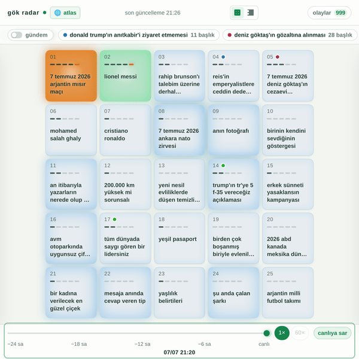
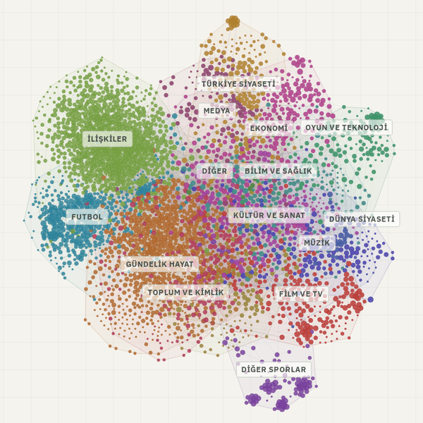
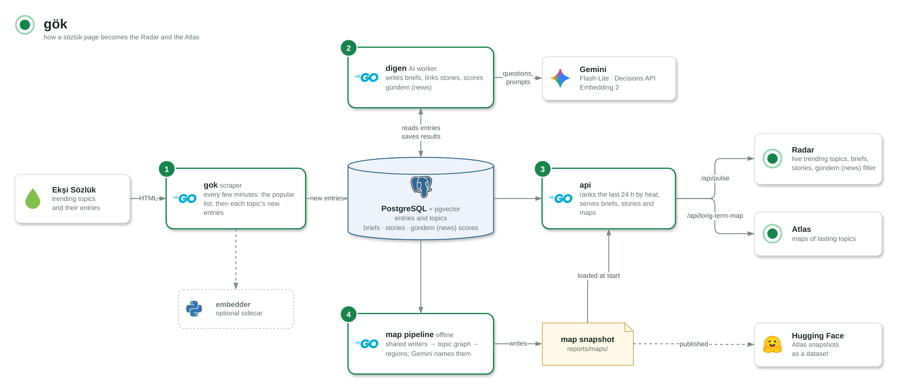

# gök

Gök is a discovery platform for Ekşi Sözlük that turns real-time data into two ways to see what people are discussing:

- [**Radar**](https://humanova.space/gok): a live view of topics gaining activity, with AI summaries, story threads, a news-only switch, activity replay and rank movement.

- [**Atlas**](https://humanova.space/gok/long-term-map): browsable maps of durable topics, built from shared writer participation.

<p align="center">
  
  
</p>

Atlas snapshots are available on [Hugging Face](https://hf.co/datasets/emir/gok-eksi-atlas).

## What It Does

### Scraping

The scraper collects trending topics and their new entries from [eksisozluk.com](https://eksisozluk.com). It paginates from the last stored entry, deduplicates in PostgreSQL, and keeps enough history for both live and long-term views.

### Radar

The Radar ranks topics by recent entry activity, shows rank changes, and animates new entries as they arrive. You can go back to any point in the last 24 hours and replay from there at `1x` or `60x`.

With Gemini configured, `digen` adds three things:

- **Briefs:** a short summary of each hot topic. A brief is rewritten only when new entries add something to it.
- **Stories:** new topics about the same event are linked into a thread. Radar shows them in a strip above the grid and as a timeline in the topic panel.
- **Gündem:** each hot topic gets a score for "is this about something happening now?". The gündem switch hides football and everyday chat.

Stories, gündem scores and the brief check are yes/no questions to the [Gemini Decisions API](https://blog.google/innovation-and-ai/technology/developers-tools/gemini-decisions-api/), which returns a probability. See [how digen works](docs/digen.md) for the jobs, their settings and the running cost.

### Atlas

Atlas is an offline snapshot of durable, recently active topics. It links topics when enough of the same writers post in both, groups them into communities and regions, lays them out, and publishes the result atomically.

A link means shared participation, not that the topics are alike. See [Map curation](docs/map-curation.md) for the selection and grouping rules.

<div align="center">

</div>

## Setup

Prerequisites: Go, PostgreSQL, and a filled-in [configuration file](configs/templates/config_template.json).

```bash
cp configs/templates/config_template.json configs/config.json

# Create the database and user (match your config)
psql -U postgres -c "CREATE USER gok WITH PASSWORD 'gok';"
psql -U postgres -c "CREATE DATABASE gok OWNER gok;"

go build -o gok ./cmd/gok      # scraper
go build -o api ./cmd/api      # Radar and Atlas
go build -o digen ./cmd/digen  # briefs, stories, gündem scores
```

## Run

Start the scraper and `digen`, then the API, and open `http://localhost:port`:

```bash
./run.sh
./api
```

`digen` needs `GeminiApiKey`. Each job has its own interval: `TopicBriefIntervalMinutes`, `StoryIntervalMinutes` and `AgendaIntervalMinutes`.

To build and publish a fresh Atlas snapshot (restart the API afterwards):

```bash
./scripts/build-map-pipeline.sh --map-name current
```

The pipeline uses Gemini to name regions and writes to `reports/maps/current/`. Use `--skip-durability --edge-days 30` to include every topic active in the last month.

## Entry Embeddings

The scraper can also embed new entries with a local sidecar. Set `EmbedderUrl` and run:

```bash
pip install -r embedder/requirements.txt
python embedder/main.py
```
