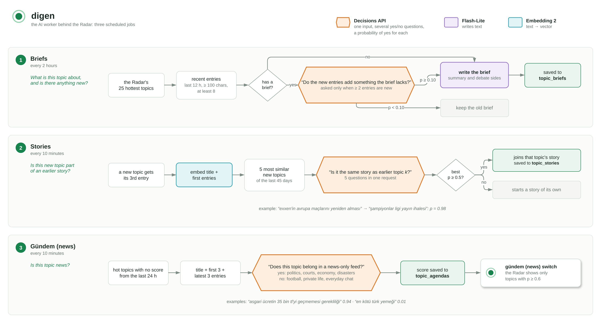

# digen

`digen` is the AI worker behind the Radar. It runs three jobs on a timer and saves their results in PostgreSQL, where the API picks them up.

The diagram is editable: open `digen.drawio.png` in [draw.io](https://app.diagrams.net).

## Settings

| Setting | Live value | What it does |
|---|---|---|
| `TopicBriefIntervalMinutes` | 120 | How often briefs are checked and rewritten. Defaults to 720. |
| `StoryIntervalMinutes` | 10 | How often new topics are linked into stories. 0 turns stories off. |
| `AgendaIntervalMinutes` | 10 | How often hot topics get a gündem (news) score. 0 turns it off. |
| `GeminiModel` | `gemini-3.5-flash-lite` | Writes the briefs. |
| `StoryModel` | `gemini-decision-1` | Answers every yes/no question: refresh check, story links, gündem. |
| `StoryEmbeddingModel` | `gemini-embedding-2` | Finds similar earlier topics for story links. |

Thresholds and limits (25 topics, 45 days, p ≥ 0.10 / 0.5 / 0.6) are constants in `internal/rag` and `internal/stories`.

## Running Cost

With the live settings and November 2026 Gemini prices, digen costs about **$12 a month**:

| Job | Model | Calls a month | Cost a month |
|---|---|---:|---:|
| Briefs | Flash-Lite | ~5,000 | ~$10.10 |
| Brief refresh check | Decisions API | ~7,200 | ~$1.50 |
| Gündem (news) scores | Decisions API | ~5,700 | ~$0.60 |
| Story links | Decisions API + Embedding 2 | ~480 each | ~$0.10 |
| **Total** | | | **~$12.30** |

- Briefs are most of the cost, and they scale with the number of runs a day: 12 at 120 minutes, 2 at the default 720.
- The story and gündem intervals change how quickly results appear, not the cost. Each new topic is linked once, and each hot topic is scored once a day.
- The refresh check skips about a quarter of brief rewrites. Without it, briefs alone would cost ~$13.50.
- A brief is about 4,300 input and 300 output tokens ($0.002). A yes/no call bills only its input, 1,000–2,000 tokens ($0.0001–0.0002), however many questions it asks.
- Not included: the server, Atlas rebuilds and `stories -old` backfills.
